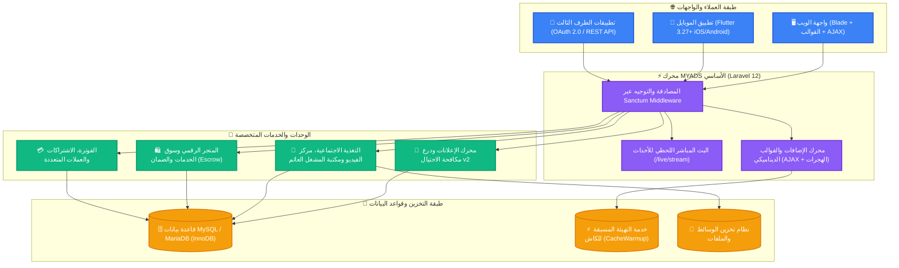

<div align="center" dir="rtl">

# 🚀 MYADS v4.6.4

### المنصة المتكاملة مفتوحة المصدر للشبكات الاجتماعية، تبادل الإعلانات والزيارات، والمتجر الرقمي

**ارتقِ بمجتمعك الرقمي مع منصة تجمع بين التفاعل الاجتماعي فائق السرعة، هندسة المنتديات الحديثة بمحررات متعددة، التبادل الإعلاني المباشر بين الأعضاء، مركز وفيديو سينمائي وشورتس على طريقة يوتيوب، المتجر الرقمي مع التقييمات، وسوق الخدمات المصغرة، مع تطبيق موبايل رسمي مبني بـ Flutter.**

مبنية ومطورة بشغف استناداً إلى **Laravel 12** و **PHP 8.2+** و **Bootstrap 5 / Flutter**.

---

[](https://github.com/mrghozzi/myads/releases)
[](https://laravel.com)
[](https://php.net)
[](https://github.com/mrghozzi/myads_app)
[](https://github.com/mrghozzi/myads/actions)
[](LICENSE)

[](https://ko-fi.com/mrghozzi)
[](https://www.patreon.com/MrGhozzi)
[](https://github.com/mrghozzi/myads/stargazers)
[](https://github.com/mrghozzi/myads/network/members)

<br/>

<a href="#-المميزات-الرئيسية"><strong>استكشاف المميزات</strong></a> •
<a href="#-التثبيت-والتشغيل-السريع"><strong>التثبيت السريع</strong></a> •
<a href="#-تطبيق-الموبايل-الرسمي-flutter"><strong>تطبيق الموبايل</strong></a> •
<a href="#-منصة-المطورين-و-rest-api"><strong>واجهة المطورين</strong></a> •
<a href="Documents/README.md"><strong>دليل التوثيق</strong></a> •
<a href="README.md"><strong>English Version</strong></a>

<br/><br/>


</div>

---

## 🌟 لماذا تختار MYADS؟

تمثل **MYADS** منظومة رقمية متكاملة للمواقع والشركات والمجتمعات على الإنترنت تغنيك عن استخدام عشرات السكربتات والخدمات المنفصلة. تجمع المنصة بين التبادل الإعلاني عالي الكفاءة، الشبكة الاجتماعية التفاعلية اللحظية، استعراض الفيديو والشورتس، التجارة الإلكترونية الرقمية، والواجهات البرمجية للمطورين في بيئة برمجية حديثة وفائقة السرعة مبنية على **Laravel 12**.

<div dir="rtl">

<table>
  <tr>
    <td width="50%">
      <h3>📢 شبكة الإعلانات والتبادل</h3>
      <p>إعلانات البنرات، الروابط النصية، تبادل الزيارات (Surf-to-earn)، تبادل مشاهدات يوتيوب، الإعلانات الذكية Smart Ads، وإعلانات الأعضاء المباشرة مع تسوية يومية بنقاط PTS وحماية متطورة من الاحتيال.</p>
    </td>
    <td width="50%">
      <h3>📺 مركز الفيديو والمشاهدة السينمائية</h3>
      <p>منصة فيديو مستوحاة من YouTube مع شاشة البطل Spotlight Hero، فلاتر التصنيف، ترتيب متعدد، صفحة مشاهدة سينمائية بنمط Theater Mode وإضاءة محيطية Ambient Glow، وشورتس رأسية 9:16.</p>
    </td>
  </tr>
  <tr>
    <td width="50%">
      <h3>💬 المنتديات الحديثة والمجتمع التفاعلي</h3>
      <p>هندسة منتديات عصرية ثنائية التقسيم وتصفح سلس بدون إعادة تحميل، محررات متقدمة (Markdown، Quill، SCEditor)، شجرة تعليقات متداخلة، شارة أفضل إجابة، إشراف ذكي بـ Groq AI، وبث لحظي بـ SSE.</p>
    </td>
    <td width="50%">
      <h3>📱 تطبيق الموبايل الأصلي (Flutter v1.8.5)</h3>
      <p>تطبيق رسمي احترافي لأنظمة أندرويد و iOS عبر (<code>myads_app</code>)، يطابق الويب 100%: مركز الفيديو والمشاهدة السينمائية، المنتديات الحديثة والردود، مراجعات المتجر، حفظ المنشورات، وطلبات الخدمات.</p>
    </td>
  </tr>
  <tr>
    <td width="50%">
      <h3>🛍️ المتجر الرقمي وسوق الخدمات</h3>
      <p>سوق إلكتروني متكامل للبرمجيات مع تقييمات 5 نجوم ومراجعات المشترين الموثوقين، معرض صور Lightbox مكبّر، معاينات حية، وسوق مناقصات للخدمات بمراحل إنجاز متكاملة.</p>
    </td>
    <td width="50%">
      <h3>⚡ لوحة تحكم الإدارة Superdesign</h3>
      <p>لوحة تحكم Duralux عصرية بنمط داكن وزجاجي، تجميع الاستعلامات في دورة واحدة (تسريع التحميل بنسبة تتجاوز 95%)، إدارة الإضافات والقوالب عبر AJAX بدون إعادة تحميل مع ترحيل الجداول تلقائياً.</p>
    </td>
  </tr>
</table>


---

## 🏗️ المخطط المعماري للنظام



---

## ✨ المميزات الرئيسية

### 📢 1. التبادل الإعلاني المتقدم ودرع مكافحة الاحتيال v2
- **إعلانات متعددة الصيغ:** بنرات قياسية (728x90, 300x250, 160x600, 468x60)، روابط نصية، بطاقات إعلانية مدمجة، وأكواد تضمين برمجية آمنة.
- **تبادل الزيارات (Surf-to-Earn):** شريط تصفح عالي السرعة مع مؤقت زمني ونظام منع التلاعب وتحويل مباشر للنقاط PTS.
- **تبادل مشاهدات يوتيوب:** زيادة عدد المشاهدات الحقيقية والتفاعل لفيديوهات الأعضاء وصناع المحتوى.
- **إعلانات الأعضاء المباشرة (`/ads/custom`):** سوق إعلاني حر بين أصحاب المواقع، توليد كود التضمين (`/embed/custom.js`)، التفاوض حول العروض، وتسوية يومية آلية لنقاط الأرباح.
- **إعلانات ذكية مع الاستهداف الجغرافي واختبارات A/B:** توجيه الحملات حسب الدولة ونوع الجهاز مع خرائط حرارية ساعية (Hourly Heatmaps) لقياس جودة النقرات.
- **منظومة الإحالات والتسويق بالعمولة المتقدمة (`/ads/referrals`, `/referral`, `/badges`):** نظام إحالات متكامل مع وسيط برمجي لحفظ كعكة الإحالة لمدة 30 يوماً (`CaptureReferral`)، دعم المعرفات المتعددة (اسم المستخدم، المعرف العام، الرقم التعريفي)، منع الإحالة الذاتية وحسابات السبام، بونص ترحيبي متبادل (+10 نقاط للمسجل الجديد و +10 نقاط للداعي)، إشعارات فورية، و 4 أوسمة إنجاز تصاعدية في مركز الشارات (`سفير مبتدئ`، `صانع المجتمع`، `المروج المحترف`، `أسطورة الإحالات`).
- **درع مكافحة الاحتيال v2 (`ADS-05`):**
  - متوافق تماماً مع **معايير العرض العالمية (IAB Viewability Standard)** (مشاهدة لا تقل عن 50% من المساحة لمدة لا تقل عن ثانية مستمرة).
  - رصد وتحديد **بصمة السلوك البشري** في الوقت الفعلي (مسار وحركة الفأرة، مدة النقر باللمس، رصد المتصفحات الخفية `navigator.webdriver`، وفحوصات معالج الرسوميات WebGL).
  - تحديد معدل الطلبات (24 ساعة لكل بصمة مجهولة)، وحظر مزارع النقرات مع توثيق سبب استبعاد النقرة (`RAPID_CLICK`, `BOT_FINGERPRINT`, `HIDDEN_TAB`, `DWELL_TOO_SHORT`).

### 📺 2. مركز الفيديو والمشاهدة السينمائية ومقاطع الشورتس
- **مركز الفيديو المطور على طريقة يوتيوب (`/video` و `/video/*`):** إعادة بناء شاملة وفق معايير `@.superdesign` مع فلاتر التصنيف الديناميكية، بانر البطل المميز 16:9 بنمط سينمائي، خيارات الترتيب المتعددة (الأحدث، الأكثر مشاهدة، الأعلى تفاعلاً، الأقدم)، رف مقاطع الشورتس مع تشغيل صامت للمقتطفات عند التمرير، وترقيم صفحات AJAX سلس بدون إعادة تحميل.
- **صفحة المشاهدة السينمائية المستقلة (`/video/watch/{id}` و `/video/{id}` و `/t{id}`):**
  - **نمط المسرح السينمائي (Theater Mode):** توسيع المشغل بنقرة واحدة لملء كامل العرض (`#btnTheater` أو اختصار لوحة المفاتيح `T`) مع حفظ الحالة في `localStorage`.
  - **الإضاءة المحيطية التفاعلية (Ambient Glow):** خلفية ضوئية ملونة مشتتة تعكس ألوان الفيديو حول المشغل (`.v-ambient-backdrop`) لتجربة سينمائية غامرة.
  - **مشغل HTML5 المخصص فائق التطور:** شريط تحكم يختفي تلقائياً عند السكون (خلال 2.5 ثانية)، شريط تقدم مع معاينة التوقيت، قائمة سرعات التشغيل (0.5x إلى 2.0x)، اختصارات لوحة المفاتيح الكاملة (`Space`/`K`، `F`، `T`، `M`، `J`/`L`، والأسهم)، والتقديم والتأخير بلمستين +/-10 ثوانٍ.
  - **المشغل العائم المصغر المزدوج (Dual PiP):** دعم ميزة الصورة في صورة للمتصفح إلى جانب المشغل العائم الداخلي التلقائي عند التمرير لأسفل الصفحة.
  - **بطاقة صانع المحتوى والتفاعل:** إطارات سداسية مع شارة التوثيق، زر المتابعة اللحظي، قائمة التفاعلات الحركية المكونة من 8 رموز تعبيرية، زر الحفظ للمشاهدة لاحقاً، قائمة المشاركة الاجتماعية، وشريط جانبي للفيديوهات المقترحة مع مفتاح التشغيل التلقائي.
- **محرك مقاطع الشورتس (`/clips`):** تجربة فيديو رأسية 9:16 تدعم إيماءات السحب واللمس، التمرير بعجلة الفأرة، وقرص الصوت المتحرك (`messages.original_audio`).
- **واجهة برمجية مخصصة للفيديو (`/api/video/feed` و `/api/video/watch/{id}`):** عزل تام لمحتوى الفيديو والتصنيفات والمقترحات لتطبيقات الهواتف والطرف الثالث.

### 💬 3. شبكة اجتماعية متكاملة وهندسة المنتديات الحديثة
- **هندسة مجتمع المنتديات العصرية (`/forum` و `/f{id}` و `/t{id}`):**
  - **تصميم ثنائي التقسيم وسريع التجاوب:** شريط جانبي ثابت للتصنيفات والوسوم مع شارات ملونة مخصصة من لوحة الإدارة (`f_cat.color`) وإحصائيات المجتمع الحية.
  - **تصفح لحظي بدون إعادة تحميل (Zero-Reload AJAX):** تصفية فورية عبر تبويبات **أحدث نشاط**، **الأبرز (الأكثر تفاعلاً)**، **الأحدث**، و **دون ردود**، مع بحث لحظي متجاوب وروابط قابلة للمشاركة والحفظ (`pushState`).
  - **حزمة المحررات المتعددة:** كتابة سلسة عبر **MyAds Markdown** مع معاينة فورية جنباً إلى جنب، **Quill.js v1.3.7**، و **SCEditor** مع دعم كامل للنمط الليلي ورفع المرفقات عبر AJAX.
  - **محرر المناقشات العائم والقابل للتثبيت:** درج محرر عائم في الأسفل يدعم التصغير والملء الكامل للشاشة لحفظ المسودات أثناء تصفح المنتدى.
  - **شجرة الردود المتداخلة (Threaded Replies):** بطاقات منشورات مرتبة زمنياً، شجرة ردود ثنائية المستوى (`parent_id`) مع خطوط ربط بصرية وشارة الإشارة لصاحب الرد الأصلي (`@User`) وحذف متسلسل.
  - **التعليقات المثبتة وشارة أفضل إجابة:** إمكانية تثبيت التعليقات المهمة في الأعلى أو تحديد "أفضل إجابة" التي تمنح صاحبها 10 نقاط سمعة وإشعاراً فورياً.
  - **شريط التمرير والإشراف الجانبي:** متتبع التقدم في الموضوع (`الرد X من Y`) مع أدوات المشرفين الفورية (تثبيت، إغلاق، تعديل، حذف).
  - **الإشراف بالذكاء الاصطناعي:** إضافة Groq AI Forum Moderator لفحص وتحليل جودة المواضيع ومطابقتها للشروط.
- **تغذية إخبارية فائقة السرعة:** تحسين شامل للاستعلامات ومنع مشاكل الأداء (Zero N+1)، مع دعم شامل للوسائط المتعددة.
- **حفظ المنشورات والإكمال التلقائي الذكي:** حفظ المنشورات بنقرة واحدة (`/statuses/save-toggle`) مع صفحة مخصصة للمحفوظات، وإكمال تلقائي فوري للإشارات `@` والوسوم `#` أثناء كتابة المنشور.
- **حزمة خصوصية الملفات الشخصية:** تحكم دقيق في خصوصية النبذة الشخصية (`public`، `followers`، `private`) وحمايتها من التسريب.
- **بث الأحداث اللحظي بتقنية Server-Sent Events (`RT-04`):** تدفق مستمر للبيانات (`/live/stream`) لتحديث شارات الرسائل والإشعارات ونشاط المجتمع.
- **نظام الحوافز والأوسمة (Gamification):** أكثر من 30 وساماً ديناميكياً (تشمل 4 أوسمة إنجاز جديدة للإحالات)، تحويل النقاط PTS، كوبونات الرصيد، ومهام يومية وأسبوعية.

### 🛍️ 4. المتجر الرقمي، سوق الخدمات والويكي
- **متجر المنتجات الرقمية:** نشر وبيع السكربتات والقوالب والإضافات بنقاط PTS أو العملات الحقيقية، مع دعم الروابط باللغة العربية واليونيكود وتتبع التنزيلات.
- **محرك تقييمات ومراجعات العملاء:** تقييمات 5 نجوم مع حساب المتوسط بدقة، أشرطة نسب توزيع التقييمات، شارة "مشتري موثوق" (`is_verified_buyer`)، وعرض مراجعات العملاء.
- **معرض الصور المكبر والمعاينات:** ألبوم صور تفاعلي مع عارض Lightbox مكبّر ملء الشاشة، وأزرار تشغيل خارجية لمعاينة الديمو الحي وفيديوهات الشرح.
- **ويكي التوثيق المتقدم (`/kb`):** صفحة توثيق ومعرفة خاصة بكل منتج تدعم Markdown ومخططات Mermaid التفاعلية.
- **سوق الخدمات المصغرة ومراحل الإنجاز (`/orders`):** نموذج مناقصات مباشر مع متتبع من 5 مراحل (المطابقة ← الترسية ← قيد التنفيذ ← التسليم ← الاكتمال)، مرفقات متطلبات المشروع، جولات طلب المراجعات، تنزيل التسليمات، وإخلاء مسؤولية صريح بعدم وجود وساطة مالية (Non-Escrow).
- **دليل المواقع المصنف 2.0 (`/directory`):** منصة استكشاف وترتيب على طريقة Product Hunt مع تصويت مجتمعي (Upvotes)، نماذج تسعير متعددة (مجاني، مجاني جزئياً، مدفوع، مفتوح المصدر، تجربة مجانية)، شارات SVG مدمجة (`/directory/{id}/badge`)، محرك إثبات ملكية المواقع، وبيانات Schema.org المنظمة لتحسين نتائج البحث.

### 💳 5. الاشتراكات والفوترة متعددة العملات
- **خطط العضويات المدفوعة:** تخصيص الفترات، المزايا التلقائية، رصيد إعلاني مجاني، خصومات ترويجية، وأوسمة مضيئة على الملف الشخصي.
- **8 بوابات دفع مدمجة:**
  - `Stripe` • `PayPal` • `Lemon Squeezy` • `Paddle` • `التحويل البنكي` (مع رفع إيصال الدفع والمراجعة اليدوية) • `Tabby` (تقسيط) • `Flouci` • ومحاكي `Apple Pay`.
- **نظام العملات المتعددة:** عملة أساسية مع تحويل تلقائي حسب أسعار الصرف، وتحكم في عدد الخانات العشرية.
- **أمان مطلق للبيانات:** لا يتم تخزين أية بيانات بطاقات ائتمانية على السيرفر المحلي؛ تتم جميع المدفوعات عبر بوابات مشفرة ومعتمدة عالمياً.

### 🛠️ 6. منصة المطورين والواجهة البرمجية OAuth 2.0
- **سيرفر OAuth 2.0 المتكامل (`/oauth/authorize`, `/oauth/token`):** مطابقة كاملة للمعيار العالمي RFC 6749، دعم معاملات الاستعلام في روابط التوجيه، والمصادقة عبر HTTP Basic Auth.
- **كتالوج تصاريح مفصل:** 27 تصريحاً (Scope) مقسمة على 7 فئات أمنية تشمل الهوية، المحتوى، الرسائل، المحفظة، المجتمع، والمتجر.
- **واجهة REST API v1 للمطورين (`/api/developer/v1/*`):** نقاط وصول برمجية لنشر المحتوى وإدارته برمجياً وجلب الملف الشخصي والمنتجات.
- **توافق مع بيئات السيرفرات المختلفة:** استخراج مرن للـ Bearer Token يعمل بكفاءة مع أباتشي و FastCGI و cPanel والبروكسي العكسي و Cloudflare.
- **جاهزية التكامل مع ووردبريس:** مهيأ للتكامل التلقائي مع إضافات النشر الآلي مثل إضافة ADStn Auto Poster.

### 🎛️ 7. لوحة تحكم الإدارة الفائقة Duralux Superdesign
- **واجهة عصرية بنمط داكن وزجاجي (`/admin`):** تجميع الاستعلامات في استعلام واحد مما **خفض زمن التحميل بنسبة تفوق 95%**.
- **محرك نصائح الإدارة اليومية:** نصيحة متجددة يومياً تظهر للمدير لتقديم إرشادات لتطوير وحماية المنصة.
- **مركز الإضافات والقوالب بتقنية AJAX:** تفعيل وتعطيل الإضافات والقوالب فورياً بدون إعادة تحميل الصفحة، مع عدادات وفلاتر تصنيف حية.
- **التنفيذ التلقائي للترحيلات والمعالجة الذاتية لقواعد البيانات:** إصلاح ذاتي وفوري لبنية الجداول مع فحص وقائي للأعمدة يضمن استقرار لوحة الإدارة ومنع أخطاء 500 على القواعد القديمة.
- **إدارة طلبات توثيق الحسابات:** لوحة إشرافية لمراجعة طلبات التوثيق، التحكم في شروط الأهلية، إدارة بنود الاتفاقية متعددة اللغات، وسجلات التدقيق اللحظية.
- **نظام الترقية الآلي الآمن للإصدارات:** تحديث النظام مباشرة من المتصفح مع ضغط تلقائي لسجلات التغيير، وفحوصات الأمان المسبقة.
- **مخصص القوالب اللحظي (`THEME-07`):** تخصيص الألوان الأساسية، الخطوط (كايرو، تجوال، إنتر، روبوتو)، حواف العناصر، والتأثير الزجاجي مع معاينة مباشرة للشاشات المختلفة (حاسوب، تابلت، جوال).
- **فحص صحة وأداء النظام:** رصد مساحات الجداول، تحسين الفهارس التالفة بنقرة واحدة (`OPTIMIZE TABLE`)، وفحص موارد الإضافات النشطة.

### 🎫 8. منتدى الدعم المستقل ونظام تذاكر الدعم الفني (v4.6.4)
- **منتدى الدعم المستقل (`/support`):** منتدى دعم فني منفصل بالكامل عن المنتدى العام بقاعدة بيانات مخصصة (`support_categories`، `support_topics`، `support_replies`). يحتوي على 5 تصنيفات متخصصة للدعم الفني، نموذج طرح الأسئلة المباشر مع إرشادات توجيهية حية (`/support/ask`)، اعتماد الحلول النموذجية (`is_solution`) من قبل المشرفين، تثبيت وقفل الأسئلة، وعداد للمشاهدات.
- **نظام تذاكر الدعم الفني المباشر (`/tickets`):** بوابة خاصة لتذاكر الدعم الفني بأرقام مرجعية فريدة غير قابلة للتصادم (`TKT-YYYYMMDD-XXXX`)، 4 أقسام تخصصية (الدعم الفني، الفوترة والمدفوعات، خدمة العملاء، الأمان وسوء الاستخدام)، 4 مستويات للأولوية (منخفضة، متوسطة، عالية، طارئة)، دعم رفع المرفقات حتى 5MB، وإمكانية إغلاق التذاكر من قبل الأعضاء.
- **إدارة الدعم في لوحة التحكم Duralux (`/admin/tickets` و `/admin/support/*`):** لوحة متكاملة لمتابعة وحل التذاكر ببطاقات KPI، فلاتر التصنيف، الردود وتحديث الحالات فورياً، إدارة أقسام منتدى الدعم بنوافذ منبثقة معزولة عن تراكب الشاشة، والإشراف على الأسئلة (تثبيت، قفل، حذف).
- **التوافق التام مع اللغات ونظام الإشعارات:** تطابق كامل بين اللغتين العربية والإنجليزية في ملفات `lang/ar/support.php` و `lang/en/support.php`، ربط مباشر من مركز المساعدة (`/help`)، وإرسال إشعارات لحظية عبر `NotificationService` لكافة تفاعلات التذاكر والمنتدى.

---

## 📱 تطبيق الموبايل الرسمي (Flutter v1.8.5+27)

تقدم المنصة تطبيق موبايل رسمي مفتوح المصدر تم بناؤه باستخدام إطار العمل الحديث **Flutter 3.27+** ليعمل بكفاءة على نظامي أندرويد و iOS (**`myads_app` v1.8.5+27**).

<div align="center">
  <a href="https://github.com/mrghozzi/myads_app">
    
  </a>
</div>

### أبرز مميزات تطبيق الموبايل:
- **مركز الفيديو والمشاهدة السينمائية (`v1.8.5`):** شاشة مخصصة `VideoHubScreen` بفلاتر تصنيف ديناميكية، ترتيب متعدد (الأحدث، الأكثر مشاهدة، الأكثر تفاعلاً، الأقدم)، توجيه مباشر `/video/watch/:id`، ورف مقاطع الشورتس.
- **محرك المنتديات الحديثة (`v1.8.4`):** تصفح الأقسام الفرعية بالألوان المخصصة، فلاتر المواضيع (أحدث نشاط، الأبرز، الأحدث، بلا ردود)، شجرة ردود متداخلة، تثبيت التعليقات، أفضل إجابة، ومحرر Markdown سريع.
- **خصوصية الملف الشخصي (`v1.8.3`):** إدراك تام لحالة خصوصية النبذة (`canViewAbout`، `aboutVisibility`)، إخفاء البيانات المحمية، وقائمة اختيار الخصوصية في الإعدادات.
- **مراجعات المتجر ومعرض الصور (`v1.8.2`):** تقييمات 5 نجوم، شارة المشتري الموثوق، أشرطة نسب التقييمات، عارض صور Lightbox مكبّر، وروابط المعاينة الحية وفيديوهات الديمو.
- **سوق طلبات الخدمات P2P (`v1.8.1`):** شريط إخلاء المسؤولية، متتبع المراحل الخمسة، عرض مرفقات المتطلبات، نافذة طلب المراجعات، تنزيل التسليمات، وإدارة كامل دورة العقد.
- **حفظ المنشورات والإكمال التلقائي (`v1.7.9`):** حفظ المنشورات بنقرة واحدة مع شاشة مخصصة للمحفوظات `SavedPostsScreen`، ونافذة الإكمال التلقائي الذكي للإشارات `@` والوسوم `#` في المحرر.
- **الأمان والخصوصية:** حفظ التوكنز مشفرة داخل شريحة الأمان بالهاتف عبر (`flutter_secure_storage`)، وتشفير الاتصال الكامل بـ HTTPS ومنع تخمين أرقام العضويات.
- **دعم كامل للغة العربية:** واجهات مصممة خصيصاً للاتجاه من اليمين إلى اليسار (RTL) وتغيير اللغة التلقائي وفق إعدادات الجهاز.

> 📖 يمكنك مراجعة [دليل تطبيق الموبايل](Documents/MOBILE_APP_GUIDE.md) والاطلاع على [مستودع الكود المصدري](https://github.com/mrghozzi/myads_app).

---

## 💻 البنية التقنية (Technology Stack)

| الطبقة | التقنية المستخدمة |
| :--- | :--- |
| **إطار عمل الخلفية (Backend)** | [Laravel 12.x](https://laravel.com/) |
| **بيئة تشغيل PHP** | PHP 8.2 أو أحدث (متوافق مع PHP 8.3 و 8.4) |
| **محرك قواعد البيانات** | MySQL 5.7+ / 8.0+ أو MariaDB 10.3+ (محرك InnoDB) |
| **واجهة الويب (Frontend)** | قوالب Blade، Bootstrap 5، وجافاسكريبت نقية (بدون أعباء SPA) |
| **تطبيق الهاتف الذكي** | [Flutter 3.27+](https://flutter.dev/) / Dart (Riverpod, Dio, SecureStorage) |
| **البث المباشر للأحداث** | Server-Sent Events (SSE) عبر خدمة `LiveEventStreamService` |
| **المصادقة والـ API** | Laravel Sanctum للموبايل، بروتوكول OAuth 2.0 للمطورين، و Socialite |
| **حزمة الاختبارات الآلية** | PHPUnit 11 (اختبارات وظيفية ووحدوية شاملة) |
| **اللغات المدعومة** | 14 لغة عالمية (`ar`, `en`, `fr`, `es`, `de`, `it`, `pt`, `ru`, `sr`, `tr`, `ja`, `zh_CN`, `zh_TW`, `fa`) مع دعم RTL الكامل |

---

## ⚡ التثبيت والتشغيل السريع

### المتطلبات الأساسية
تأكد من توفر المتطلبات التالية على خادمك قبل التثبيت:
- **PHP:** إصدار `^8.2` مع الحزم التالية: `BCMath`, `Ctype`, `cURL`, `DOM`, `Fileinfo`, `JSON`, `Mbstring`, `OpenSSL`, `PCRE`, `PDO MySQL`, `Tokenizer`, `XML`.
- **قاعدة البيانات:** MySQL 5.7+ أو MariaDB 10.3+.
- **الأدوات:** Composer 2.x و Node.js 18+ (لتجميع ملفات الواجهة محلياً).

### 1. التثبيت السريع عبر مثبت الويب (Web Installer)

1. **استنساخ أو تحميل المشروع:**
   ```bash
   git clone https://github.com/mrghozzi/myads.git
   cd myads
   ```

2. **تثبيت حزم PHP والواجهة:**
   ```bash
   composer install --optimize-autoloader --no-dev
   npm install && npm run build
   ```

3. **إعداد مسار الخادم:**
   - قم بتوجيه مسار النطاق (Document Root) إلى مجلد `public/`.
   - في حال استخدام استضافة مشتركة على أباتشي، سيتولى ملف `.htaccess` المرفق في المسار الرئيسي عملية التوجيه تلقائياً.

4. **تشغيل معالج التثبيت المرئي:**
   افتح المتصفح وانتقل إلى الرابط التالي:
   ```text
   http://your-domain.com/install
   ```
   اتبع خطوات المعالج المكونة من 5 مراحل للتحقق من أذونات المجلدات، ربط قاعدة البيانات، إنشاء مفتاح التشفير، تنفيذ الهجرات، وإنشاء حساب المدير العام.

---

### 2. التثبيت اليدوي للمطورين عبر سطر الأوامر (CLI)

```bash
# 1. استنساخ المستودع
git clone https://github.com/mrghozzi/myads.git && cd myads

# 2. تثبيت الحزم البرمجية
composer install
npm install

# 3. إعداد ملف البيئة
cp .env.example .env
php artisan key:generate

# 4. قم بإدخال بيانات الاتصال بقاعدة البيانات في ملف .env ثم شغل الهجرات:
php artisan migrate --force

# 5. بناء ملفات الواجهة وتشغيل السيرفر التجريبي:
npm run build
php artisan serve
```

أصبح موقعك الآن جاهزاً ويعمل محلياً على الرابط: `http://127.0.0.1:8000`! 🎉

---

## 🔌 منصة المطورين و REST API

تحتوي المنصة على منظومة برمجية متكاملة لربط التطبيقات الخارجية وسيرفر OAuth 2.0 للمصادقة.

### مثال: نشر تدوينة جديدة في المجتمع عبر REST API
```bash
curl -X POST "https://your-domain.com/api/developer/v1/me/content" \
     -H "Authorization: Bearer YOUR_ACCESS_TOKEN" \
     -H "Content-Type: application/json" \
     -H "Accept: application/json" \
     -d '{
       "content": "سعداء جداً بإطلاق منصتنا الجديدة عبر MYADS! 🚀 #ابتكار",
       "media_type": "text",
       "privacy": "public"
     }'
```

### لمحة عن التصاريح (Scopes) المدعومة:
- `user.identity.read` • `user.profile.read` • `user.profile.write`
- `user.content.read` • `user.content.write` (مع الأسماء البديلة `content.write` و `posts.write`)
- `user.messages.read` • `user.messages.send`
- `user.wallet.read` • `user.community.read` • `store.products.read`

> 📖 للمزيد من التفاصيل حول جميع نقاط الوصول البرمجية وأمثلة الاستدعاء، راجع [توثيق الـ API الشامل](Documents/API_DOCS.md).

---

## 📚 فهرس التوثيق الشامل

تتوفر أدلة تفصيلية متخصصة لكل قسم داخل مجلد التوثيق [`Documents/`](Documents/):

| الدليل | الوصف |
| :--- | :--- |
| 📖 [**دليل المنصة الشامل**](Documents/README.md) | شرح وافٍ لمعمارية النظام وجميع وحداته ووظائفه. |
| ⚙️ [**دليل التثبيت والإعداد**](Documents/INSTALLATION.md) | شرح التثبيت على سيرفرات أباتشي، إنجنكس، و cPanel خطوة بخطوة. |
| 📋 [**متطلبات النظام**](Documents/SYSTEM_REQUIREMENTS.md) | القائمة الكاملة لإضافات PHP وإعدادات السيرفر الموصى بها. |
| 🎨 [**دليل تطوير القوالب**](Documents/THEME_GUIDE.md) | كيفية إنشاء قوالب جديدة والربط مع مخصص القوالب اللحظي. |
| 🔌 [**دليل برمجة الإضافات**](Documents/PLUGIN_GUIDE.md) | كيفية بناء إضافات مخصصة وتسجيل الخطافات والودجات البرمجية. |
| 📱 [**دليل تطبيق الموبايل**](Documents/MOBILE_APP_GUIDE.md) | كيفية بناء وتوصيل تطبيق فلاتر (`myads_app`) مع موقعك. |
| 💳 [**دليل الاشتراكات والفوترة**](Documents/PAID_SUBSCRIPTIONS_GUIDE.md) | إعداد خطط العضويات وربط بوابات الدفع والـ Webhooks. |
| 📡 [**توثيق الـ REST API**](Documents/API_DOCS.md) | مواصفات واجهة برمجة التطبيقات للمطورين وتطبيق الموبايل. |
| 🚀 [**دليل الترقية والتحديث**](Documents/UPGRADE.md) | إجراءات ترقية النظام وتحديث جداول قاعدة البيانات بأمان تام. |
| 📜 [**سجل التغييرات والتحديثات**](Documents/changelogs.md) | تاريخ كافة الإصدارات والتحسينات الأمنية والتطويرات. |

---

## 🤝 المساهمة والمجتمع البرمجي

نرحب بشدة بجميع المساهمات والأفكار والتطويرات البرمجية من مجتمع المطورين!

1. **قم بعمل Fork للمشروع**
2. **أنشئ فرعاً لتطويرك** (`git checkout -b feature/AmazingFeature`)
3. **احفظ التعديلات** (`git commit -m 'Add some AmazingFeature'`)
4. **ارفع التعديل إلى فرعك** (`git push origin feature/AmazingFeature`)
5. **افتح طلب سحب (Pull Request)**

يرجى مراجعة [إرشادات المساهمة](CONTRIBUTING.md)، [ميثاق السلوك الأخلاقي](CODE_OF_CONDUCT.md)، و [سياسة الأمان](SECURITY.md).

---

## ⭐ تاريخ النجوم ودعم المشروع

إذا نالت منصة **MYADS** إعجابك أو ساعدتك في تطوير مشاريعك، **يرجى دعم المشروع بنجمة (Star) على جيت هاب!** ⭐  
دعمكم هو الحافز الأكبر لمواصلة التطوير وتقديم تحديثات مستمرة للمجتمع مفتوح المصدر.

<div align="center">
  <a href="https://github.com/mrghozzi/myads/stargazers">
    
  </a>
</div>

---

## 💖 الرعاية والدعم المالي

منصة **MYADS** برمجية مجانية ومفتوحة المصدر يتم تطويرها وصيانتها بواسطة **[mrghozzi](https://github.com/mrghozzi)**. إذا كانت المنصة تقدم قيمة مضافة لأعمالك أو موقعك، يمكنك دعم استمرارية التطوير عبر:

<div align="center">

[](https://ko-fi.com/mrghozzi)
&nbsp;&nbsp;&nbsp;&nbsp;
[](https://www.patreon.com/MrGhozzi)

</div>

---

## 📄 الترخيص

تخضع منصة **MYADS** لشروط **[ترخيص MIT](LICENSE)**. يحق لك استخدامها وتعديلها وإعادة توزيعها مجاناً للأغراض الشخصية والتجارية.

<div align="center">
  <sub>صُنعت بكل حب ❤️ بواسطة <a href="https://github.com/mrghozzi">mrghozzi</a> والمجتمع مفتوح المصدر.</sub>
</div>
